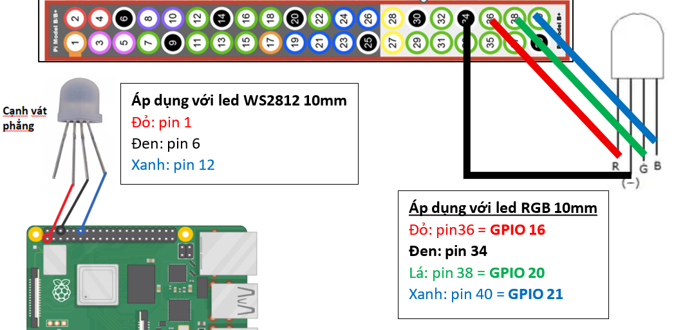

# TJBOT DEV DOCUMENT

<!-- TOC -->

- [OS và khởi động](#os-và-khởi-động)
- [Lắp ngoại vi](#lắp-ngoại-vi)
    - [Cánh tay servo](#cánh-tay-servo)
    - [Led trên đầu](#led-trên-đầu)
- [Cấu hình MQTT trên Raspberry Pi để điều khiển Robot](#cấu-hình-mqtt-trên-raspberry-pi-để-điều-khiển-robot)
    - [Bước 1: Tạo môi trường ảo VENV và cài thư viện MQTT](#bước-1-tạo-môi-trường-ảo-venv-và-cài-thư-viện-mqtt)
    - [Bước 2: Viết mã nguồn Python xử lý MQTT tjbot_client.py](#bước-2-viết-mã-nguồn-python-xử-lý-mqtt-tjbot_clientpy)
    - [Bước 3: Biến file code thành "Tiến trình chạy ngầm" Systemd Service](#bước-3-biến-file-code-thành-tiến-trình-chạy-ngầm-systemd-service)
    - [Bước 4: Kích hoạt service và kiểm tra tiến trình](#bước-4-kích-hoạt-service-và-kiểm-tra-tiến-trình)
- [Nâng cấp: Giám sát mạng WiFi và đăng kí mới](#nâng-cấp-giám-sát-mạng-wifi-và-đăng-kí-mới)
    - [Giải pháp cấu hình Bluetooth thành Serial UART RFCOMM](#giải-pháp-cấu-hình-bluetooth-thành-serial-uart-rfcomm)
    - [🔍 wifiscan - tìm mạng wifi](#-wifiscan---tìm-mạng-wifi)
    - [💾 addwifissid, matkhauday - lưu trữ](#-addwifissid-matkhauday---lưu-trữ)
    - [📋 listwifi - liệt kê](#-listwifi---liệt-kê)
    - [🗑️ delwifissid - xóa](#-delwifissid---xóa)
    - [Chạy dịch vụ](#chạy-dịch-vụ)
- [Sefttest](#sefttest)

<!-- /TOC -->

## OS và khởi động

1. Tải về công cụ cài đặt OS:
    - Link chính thức: <https://www.raspberrypi.com/software/>
    - Kho các phiên bản: <https://downloads.raspberrypi.com/imager/>
2. Tải về Rasberry Pi OS từ link:
    - Phiên bản Bulleys mới nhất và vẫn còn khả năng can thiệp sâu vào device: <https://downloads.raspberrypi.org/raspios_lite_arm64/images/raspios_lite_arm64-2023-05-03/>.\
    Đang cài đặt với phiên bản **bookworm 64bit lite**.
    - Các OS cũ: <https://downloads.raspberrypi.org/raspios_lite_arm64/images/>
3. Sử dụng **Rasberry Pi imager** để burn image lên thẻ nhớ.
    - Tài khoản: pi
    - Mật khẩu: raspberry
    - Bật SSH
4. **Cấu hình kích hoạt UART khi khởi động**:
    1. Xem thẻ nhớ với phân vùng **bootfs** trên máy tính cá nhân
    2. Tìm file có tên là **config.txt** và mở nó bằng một trình soạn thảo văn bản (như Notepad)
    3. Kéo xuống dưới cùng và thêm các dòng sau vào. 
        - Mục đích là để kích hoạt chức năng UART trên các chân GPIO

            ```plain
            enable_uart=1
            ```

        - Mục đích: biến cổng Usb Type C để truyền UART luôn, nhưng phải hi sinh chức năng nối bàn phím, chuột thì hãy bổ sung cáu hình nữa:

            ```plain
            dtoverlay=dwc2,dr_mode=peripheral
            ```

            và đồng thời xóa cum [cm5] di vì nó nhằm kích hoạt tính năng kết nối chuột và bàn phím nên sẽ gây xung đột.

            ```plain
            [cm5]
            dtoverlay=dwc2,dr_mode=host
            ```

        - Mục đích: phát được âm thanh ra loa, không bị lỗi phân quyển

            Tìm đến dòng bên dưới và đảm bảo nó được đặt là on

            ```plain
            [cm5]
            dtparam=audio=on
            ```

    4. Nếu muốn dùng Usb Type C để truyền UART thì còn 2 bước thực hiện sau đây, nếu không muốn thì bỏ qua bước 4,5 .\
    Tìm file có tên là **cmdline.txt** và mở nó bằng một trình soạn thảo văn bản (như Notepad).\
    Tìm tới đoạn cấu hình `modules-load=dwc2,g_others` và thay thế bằng `modules-load=dwc2,g_serial`.
    5. Và tiếp theo là chạy service phục vụ ở cổng UART đó.

        ```shell
        sudo systemctl enable getty@ttyGS0.service
        sudo systemctl start getty@ttyGS0.service
        ```

    6. Lưu file lại, an toàn rút thẻ nhớ ra và cắm lại vào Raspberry Pi 4.

    7. Để phát âm thanh ra loa theo đường aux 3.5mm, chứ không phải hdmi, thì cần thêm lệnh

        '''shell
        sudo raspi-config
        ```

        - Giao diện màu xanh sẽ hiện ra, bạn dùng phím mũi tên chọn: System Options (hoặc Advanced Options tùy phiên bản).
        - Chọn tiếp: Audio.
        - Chọn cổng: Headphones (hoặc AV Jack / Analog).
        - Chọn Finish để lưu và thoát ra ngoài.

    8. Để chỉnh âm lượng loa thật to, hãy chạy lệnh

        '''shell
        alsamixer
        ```
        
        - Một giao diện cột sóng hiện ra, bạn dùng nút Mũi tên lên để kéo cột Headphones hoặc Master lên mức 100 (vạch màu xanh sát đỉnh màu đỏ).
        - Nhấn nút ESC để thoát.
        - Lưu cấu hình âm lượng này vĩnh viễn không bị mất khi rút điện, chạy lệnh:

            '''shell
            sudo alsactl store
            ``` 
    9. Để tài khoản pi được quyển sử dụng âm thanh (bị cấm mặc định), cần cấp quyền bằng lệnh

        ```shell
        USER=pi
        sudo usermod -aG audio $USER
        ```

        và cài các gói phụ thuộc

        ```shell
        sudo apt-get update
        sudo apt-get install -y libsdl2-mixer-2.0-0 libportmidi0 libsdl2-image-2.0-0 libsdl2-ttf-2.0-0
        ```

        và dùng lênh sau để kiểm tra âm thanh

        ```shell
        speaker-test -c2 -t wav
        ```

5. Kết nối **Rasberry Pi** với module **usb2serial** theo qui tắc noối dây: 
    
    
6. Khởi động lại **Rasberry Pi** với thẻ và mở cổng COM ở tốc độ **115200**. Đợi khoảng 10 giây thì sẽ thấy kết quả như sau
    

## Lắp ngoại vi

### Cánh tay servo


### Led trên đầu

Led RGB 10mm Cathod chung



## Cấu hình MQTT trên Raspberry Pi để điều khiển Robot

### Bước 1: Tạo môi trường ảo (VENV) và cài thư viện MQTT

```shell
# 1. Tạo thư mục dự án cho TJBot và di chuyển vào trong
mkdir ~/tjbot_mqtt && cd ~/tjbot_mqtt

# 2. Tạo môi trường ảo tên là venv
python -m venv venv

# 3. Kích hoạt môi trường ảo
source venv/bin/activate

# 4. Cài đặt thư viện python
pip install -r requirements 
```

### Bước 2: Viết mã nguồn Python xử lý MQTT (tjbot_client.py)

Chức năng chính: Soạn file [**/home/pi/tjbot_mqtt/tjbot_client.py**](./tjbot_client.py) với nội dung như đính kèm.\
Chưc năng giám sát wifi: Soạn file [**/home/pi/tjbot_conn/wifi_monitor.py**](./wifi_monitor.py) với nội dung như đính kèm.

### Bước 3: Biến file code thành "Tiến trình chạy ngầm" (Systemd Service)

Để code này tự chạy ngay khi bật nguồn Pi mà bạn không cần phải mở PuTTY lên gõ lệnh, hãy tạo một file Service cho hệ thống quản lý

Service chính: [**/etc/systemd/system/tjbot.service**](./tjbot.service)\
Service giám sát wifi: [**/etc/systemd/system/wifi-monitor.service**](./wifi-monitor.service)

### Bước 4: Kích hoạt service và kiểm tra tiến trình

Nếu đây là lần đầu tiên kích hoạt service thì cần cài đặt như sau

```shell
# Nạp lại cấu hình hệ thống
sudo systemctl daemon-reload

# Cho phép tiến trình tự khởi động cùng hệ thống khi bật nguồn
sudo systemctl enable tjbot.service

# Khởi động tiến trình ngay lập tức
sudo systemctl start tjbot.service

# Kiểm tra tiến trình xem đã chạy chưa
sudo systemctl status tjbot.service
```

Làm tương tự vởi servie giám sát wifi.

Nếu service đã chạy và cần cập nhật [Code](#bước-2-viết-mã-nguồn-python-xử-lý-mqtt-tjbot_clientpy) thì cần chạy lại service như sau

```shell

# Nạp tải lại code mới
sudo systemctl restart tjbot.service

# Kiểm tra tiến trình xem đã chạy chưa
sudo systemctl status tjbot.service

# Xem chi tiết báo lỗi
sudo journalctl -u tjbot.service -n 50 --no-pager
```

## Nâng cấp: Giám sát mạng WiFi và đăng kí mới

Việc giám sát mạng WiFi được thực hiện qua file chức năng [wifi_monitor.py](./wifi_monitor.py), được biến thành service thường trú bởi đăng kí [wifi-monitor.service](./wifi-monitor.service)

**Việc đăng kí mới ** được thực hiện qua bluetooth:
> biến Raspberry Pi thành một thiết bị Bluetooth Classic (chế độ SPP - Serial Port Profile) để giả lập cổng Serial ảo (Virtual UART) là phương án tối ưu. Người dùng chỉ cần bật điện thoại/máy tính, kết nối Bluetooth, truy cập vào một trang web hỗ trợ WebSerial/WebBluetooth (hoặc ứng dụng Serial Terminal) là có thể gõ lệnh tương tác được ngay.

### Giải pháp cấu hình Bluetooth thành Serial UART (RFCOMM)

Để Raspberry Pi có thể phát ra Bluetooth và tự động mở một cổng Serial ảo chờ trang web kết nối, sử dụng công cụ **RFCOMM** của giao thức **Bluetooth Linux** (bluez).

Nguyên lý hoạt động: Ta cấu hình chip Bluetooth trên Pi chạy ở chế độ **SPP** (Serial Port Profile). Khi có một thiết bị (điện thoại/máy tính) kết nối vào, Linux sẽ tự động ánh xạ luồng dữ liệu Bluetooth đó thành một file cổng ảo trong hệ thống tại đường dẫn /dev/rfcomm0.

Cách phần mềm xử lý: Tiến trình Python chỉ cần đọc/ghi vào file **/dev/rfcomm0** này y hệt như đang đọc/ghi một cổng Serial vật lý (UART) thông thường thông qua thư viện **pyserial**.

- Bỏ lệnh cấm của hệ thống đối với chip Bluetooth:

    ```shell
    sudo rfkill unblock bluetooth
    ```

- Khởi động lại dịch vụ Bluetooth của hệ điều hành

    ```shell
    sudo systemctl restart bluetooth
    ```

- Mở giao diện cli điều khiển bluetooth

    ```shell
    sudo bluetoothctl
    ```

- Kích hoạt các tính năng của mạng bluetooth

    ```shell
    power on
    discoverable on
    pairable on
    agent NoInputNoOutput
    default-agent
    ```

    _Câu lệnh agent NoInputNoOutput sẽ cấu hình cho Pi hiểu rằng: "Đây là thiết bị không có màn hình/bàn phím để nhập mã PIN, hãy tự động đồng ý ghép đôi với mọi thiết bị an toàn yêu cầu kết nối"._
_
- Thoát khỏi giao diện cấu hình bluetooth

    ```shell
    exit
    ```

- Cho phép quét thấy và Kích hoạt cấu hình SPP (Serial Port Profile)


### 🔍 wifiscan() - tìm mạng wifi

- Cách Pi xử lý: Python sẽ gọi lệnh hệ thống `sudo iwlist wlan0 scan` hoặc sử dụng bộ công cụ `nmcli` (NetworkManager) qua câu lệnh: `nmcli -t -f SSID,SIGNAL device wifi list`.
- Kết quả trả về: Lệnh này chạy rất nhanh 1~2 giây. Python sẽ lọc ra danh sách tên Wi-Fi (SSID) và độ mạnh tín hiệu (RSSI), sau đó định dạng thành chuỗi (hoặc mảng JSON) để đẩy ngược lại qua cổng Serial cho trang web hiển thị thành một danh sách cho người dùng chọn.

### 💾 addwifi(ssid, matkhauday) - lưu trữ

- Cách Pi xử lý: Không trực tiếp sửa file `/etc/wpa_supplicant/wpa_supplicant.conf` mà gián tiếp thông qua lệnh hệ thống của NetworkManager:

  ```shell
  nmcli device wifi connect "TÊN_WIFI" password "MẬT_KHẨU"
  ```

- Kết quả trả về: Lệnh này vừa lưu cấu hình, vừa ép Pi thử kết nối ngay lập tức. Nếu thành công, Pi trả về **CONNECTED_SUCCESS**, nếu sai mật khẩu sẽ trả về **AUTH_FAILED**.

### 📋 listwifi() - liệt kê

- Cách Pi xử lý: Để xem các mạng Wi-Fi đã được lưu trong bo mạch, Python sẽ chạy lệnh:

    ```shell
    nmcli -t -f NAME,UUID connection show --active=no
    ```

    _(Để lấy cả mật khẩu đã lưu phục vụ việc hiển thị lên trang web, Pi có thể truy cập vào thư mục cấu hình hệ thống /etc/NetworkManager/system-connections/ để đọc khóa psk)._

- Kết quả trả về: Trả về danh sách các mạng kèm mật khẩu dạng text để trang web đồng bộ.

### 🗑️ delwifi(ssid) - xóa

- Cách Pi xử lý: Python sẽ ra lệnh cho hệ thống xóa bỏ profile cấu hình của mạng Wi-Fi đó để Pi không bao giờ tự động kết nối lại nữa:

    ```shell
    nmcli connection delete "TÊN_WIFI"
    ```

- Kết quả trả về: Trả về DELETED_SUCCESS để trang web cập nhật lại giao diện (gỡ Wi-Fi đó ra khỏi danh sách đã lưu).

### Chạy dịch vụ

```shell
# 1. Ép Systemd đọc lại toàn bộ các file service vừa sửa đổi
sudo systemctl daemon-reload

# 2. Cho phép dịch vụ tự động chạy khi khởi động nguồn Raspberry Pi
sudo systemctl enable wifi_provisioning.service

# 3. Ra lệnh Khởi chạy dịch vụ ngay lập tức
sudo systemctl restart wifi_provisioning.service
```

## Sefttest

Kiểm tra các chức năng hoạt động. Phải chạy với sudo để còn giành quyển điều khiển led ACT, audio

```shell
source venv/bin/activate
python3 selftest.py
```

hoặc

```shell
sudo ./venv/bin/python ./selftest.py
```
