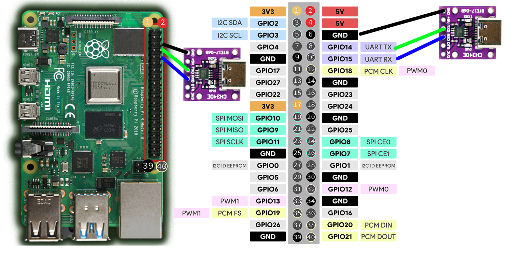
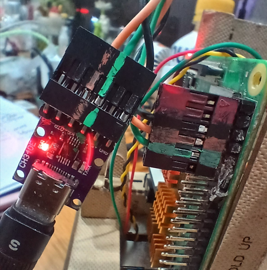
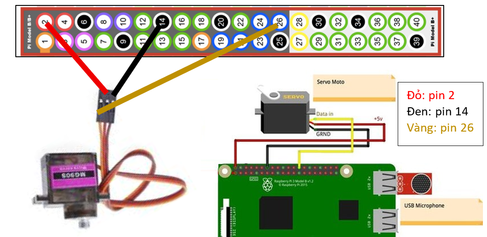

# TJBOT DEV DOCUMENT

## OS và khởi động

1. Tải về công cụ cài đặt OS:
    - Link chính thức: <https://www.raspberrypi.com/software/>
    - Kho các phiên bản: <https://downloads.raspberrypi.com/imager/>
2. Tải về Rasberry Pi OS từ link:
    - Phiên bản Bulleys mới nhất và vẫn còn khả năng can thiệp sâu vào device: <https://downloads.raspberrypi.org/raspios_lite_arm64/images/raspios_lite_arm64-2023-05-03/>.\
    Đang cài đặt với phiên bản **bookworm 64bit lite**.
    - Các OS cũ: <https://downloads.raspberrypi.org/raspios_lite_arm64/images/>
3. Sử dụng **Rasberry Pi imager** để burn image lên thẻ nhớ.
    - Tài khoản: pi
    - Mật khẩu: raspberry
    - Bật SSH
4. **Cấu hình kích hoạt UART khi khởi động**:
    1. Xem thẻ nhớ với phân vùng **bootfs** trên máy tính cá nhân
    2. Tìm file có tên là **config.txt** và mở nó bằng một trình soạn thảo văn bản (như Notepad)
    3. Kéo xuống dưới cùng và thêm dòng sau vào:

        ```plain
        enable_uart=1
        ```

    4. Lưu file lại, an toàn rút thẻ nhớ ra và cắm lại vào Raspberry Pi 4.
5. Kết nối **Rasberry Pi** với module **usb2serial** theo qui tắc noối dây: 
    
    
6. Khởi động lại **Rasberry Pi** với thẻ và mở cổng COM ở tốc độ **115200**. Đợi khoảng 10 giây thì sẽ thấy kết quả như sau
    

## Lắp ngoại vi

### Cánh tay servo



## Cấu hình MQTT trên Raspberry Pi để điều khiển Robot

### Bước 1: Tạo môi trường ảo (VENV) và cài thư viện MQTT

```shell
# 1. Tạo thư mục dự án cho TJBot và di chuyển vào trong
mkdir ~/tjbot_mqtt && cd ~/tjbot_mqtt

# 2. Tạo môi trường ảo tên là venv
python -m venv venv

# 3. Kích hoạt môi trường ảo
source venv/bin/activate

# 4. Cài đặt thư viện MQTT (paho-mqtt)
pip install paho-mqtt
```

### Bước 2: Viết mã nguồn Python xử lý MQTT (tjbot_client.py)

Soạn file [**/home/pi/tjbot_mqtt/tjbot_client.py**](./tjbot_client.py) với nội dung như đính kèm.

### Bước 3: Biến file code thành "Tiến trình chạy ngầm" (Systemd Service)

Để code này tự chạy ngay khi bật nguồn Pi mà bạn không cần phải mở PuTTY lên gõ lệnh, hãy tạo một file Service cho hệ thống quản lý

[**/etc/systemd/system/tjbot.service**](./tjbot.service)

### Bước 4: Kích hoạt service và kiểm tra tiến trình

Nếu đây là lần đầu tiên kích hoạt service thì cần cài đặt như sau

```shell
# Nạp lại cấu hình hệ thống
sudo systemctl daemon-reload

# Cho phép tiến trình tự khởi động cùng hệ thống khi bật nguồn
sudo systemctl enable tjbot.service

# Khởi động tiến trình ngay lập tức
sudo systemctl start tjbot.service

# Kiểm tra tiến trình xem đã chạy chưa
sudo systemctl status tjbot.service
```

Nếu service đã chạy và cần cập nhật [Code](#bước-2-viết-mã-nguồn-python-xử-lý-mqtt-tjbot_clientpy) thì cần chạy lại service như sau

```shell

# Nạp tải lại code mới
sudo systemctl restart tjbot.service

# Kiểm tra tiến trình xem đã chạy chưa
sudo systemctl status tjbot.service

# Xem chi tiết báo lỗi
sudo journalctl -u tjbot.service -n 50 --no-pager
```

## Sefttest

Kiểm tra các chức năng hoạt động. Phải chạy với sudo để còn giành quyển điều khiển led ACT, audio

```shell
source venv/bin/activate
python3 selftest.py
```

hoặc

```shell
sudo ./venv/bin/python ./selftest.py
```
